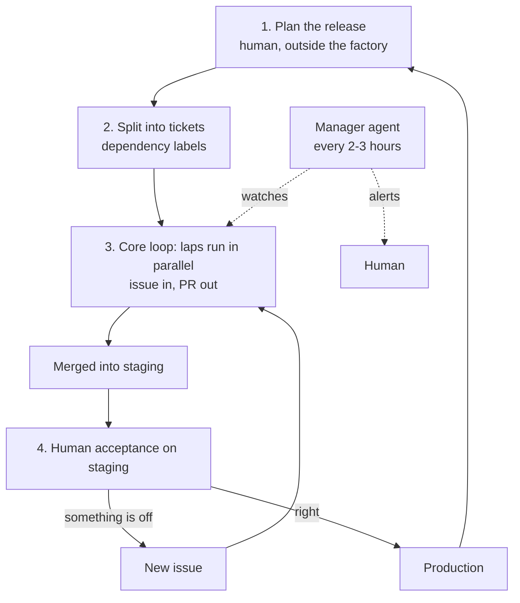

# AI software factory: technical breakdown

A reference distilled from the transcript of "My AI Dark Factory Dream Is
Dead (Here's What Actually Works)". See the
[transcript](my-ai-dark-factory-dream-is-dead.md) and the
[video](https://www.youtube.com/watch?v=GQatuTWSRqY). The presenter's
factory is published as
[ai-software-factory](https://github.com/coleam00/ai-software-factory),
and this repository carries it as a read-only submodule at
[`reference/ai-software-factory`](../../reference/ai-software-factory).

The captions are auto-generated. "Labs" in the captions means "laps", and
"Cloud Code" means Claude Code. "Jev" is a real model: a small decision
model for classification, routing and scoring that returns typed outputs
with confidence scores ([jevai.net](https://jevai.net/)).

## Thesis

A dark factory is level 5 in Dan Shapiro's five levels of AI coding
autonomy. It takes one high-level document for a whole application, splits
it into issues, builds, validates, and ships to production with no human
after the input. The presenter built one and gave it up. Better models
would not rescue it, for two reasons.

1. **Intent is the bottleneck.** Models keep getting better at building
   software but not much better at knowing what you want. No one specifies
   features or maintenance preferences completely, and a dark factory lets
   the agent fill those gaps with guesses.
2. **Agents don't keep a codebase maintainable.** They sprawl, so humans
   have to stay involved in maintenance. Dex Horthy makes this argument in
   his talk on why software factories fail. He also started with a dark
   factory and added human checkpoints to make it work.

The replacement is a software factory. It keeps the autonomous per-ticket
loop and changes what happens around it. A human scopes each release
before the loop runs, and a human accepts the result on staging before it
reaches production.

## Dark factory vs software factory

| | Dark factory | Software factory |
|---|---|---|
| Input | One high-level doc for the whole app | One release: a proof of concept for greenfield, a small epic for brownfield |
| Gaps in intent | The agent guesses | The human fills them during planning |
| Ticket split | Agent, unreviewed | Agent, with an optional human review |
| Per-ticket loop | Autonomous | Autonomous, unchanged |
| Ships to | Production | Staging; a human promotes to production |
| Human role | None after the input | Plans, sets optional gates, accepts on staging, rescues on alert |

## Pipeline

## Stage 1: plan the release

Planning sits outside the factory on purpose. Use the method you already
have, such as a PRD or an architecture doc. The factory doesn't walk you
through it, because the presenter wants to stay fully involved here and
doesn't want to impose one planning style.

Greenfield work gets a proof of concept as its first release. Brownfield
work gets a small epic. The presenter's size heuristic is an epic that
splits into 10 to 20 tickets; you calibrate it by running the system.

The epic document holds three things:

1. What we are building.
2. What we are explicitly not building. The out-of-scope list keeps
   steering the agents while they work through tickets.
3. The holdout scenarios.

### Holdout scenarios

A holdout scenario is an acceptance test written up front and run during
validation, after implementation. The builder agent never sees it. Agents
are sycophantic. If they know the tests, they shape the implementation to
pass them, and you get software built for the tests instead of software
built well.

The presenter credits holdouts with a large gain in reliability and
recommends them for any agentic workflow, factory or not. In practice the
holdout section of the epic has to stay out of the builder's context and
reach only the validator.

## Stage 2: split into tickets

- The factory takes the epic doc and helps split it into issues. The demo
  uses GitHub issues; Jira works the same way.
- It maps dependencies, deciding which tickets can run in parallel and
  which must run in order.
- It encodes those dependencies as GitHub labels, so laps build and test
  things in a valid order.
- A human can review the split before building starts. This gate is
  optional.

## Stage 3: the core loop

One run of the loop is a lap. An issue goes in and a pull request comes
out. Many laps run in parallel, which the dependency mapping makes safe.

1. **Claim.** Pick one ready issue and apply a claim label so other laps
   skip it.
2. **Triage complexity.** Jev, a cheap decision model, sorts the ticket
   as simple or complex. A simple ticket gets a fast build workflow. A complex one
   gets a staged workflow with iteration. In the first version every
   ticket ran the full workflow, and trivial tickets took 20 to 30
   minutes.
3. **Build.**
4. **Validate.** The agent checks that the app works. The factory gives it
   tools to drive the application as a user would, clicking buttons and
   typing into a chat input. This replaces most manual testing. The
   holdout scenarios run here.
5. **Review the code.** Once the app is known to work, a reviewer checks
   simplicity, maintainability, and whether the implementation took the
   right approach. Validation and review both scale their effort to the
   ticket's complexity.
6. **Fix.** Anything validation or review rejects goes back to
   implementation, always through the simple workflow, even for a complex
   ticket. A retry cap stops infinite loops.
7. **Merge.** The PR merges into the branch that feeds staging only if CI
   is green and review passed.

| | Validation | Code review |
|---|---|---|
| Question | Does the app behave correctly? | Is the code well built? |
| Method | Drive the running app like a user | Read the diff |
| Checks | Behavior, holdout scenarios | Simplicity, maintainability, approach |
| Order | First | Second, on code known to work |

## Manager agent

The manager runs every two or three hours across all laps. It is the most
recent addition and brought another reliability gain.

Laps don't talk to each other. No single lap notices that dependencies
have shifted or that another PR is stuck. The manager covers that gap:

- it surveys the progress of all laps;
- it realigns issues when dependencies change;
- it takes over a stuck workflow, such as one that hit the retry cap, and
  finishes it;
- it alerts the human when a person is needed.

Rescues are expected and occasional, such as reviewing a split or saving a
workflow. The presenter handles alerts with their main Claude Code session.

## Protected core context

A file called `mission.md` or `engineering.md` holds the things that are
out of scope forever, plus high-level direction for how agents work in the
codebase. Think of it as global rules and mission in one file.

The factory must never edit it, and review checks for that. A factory that
can edit this file can change its own permissions and behavior.

## Model routing

Each node can use a different model, even from a different provider.
Planning gets the strongest models; the talk names Opus 5.5 and GPT-6
Astra. Task picking and triage use Jev, a classifier rather than an LLM.
Simple builds and shipping use a cheaper LLM such as Sonnet 5.5. The
presenter runs hundreds of laps a week without hitting rate limits.

## Stage 4: human acceptance on staging

When the epic's issues have merged into staging, the human tests. This is
the step that verifies intent.

Feedback goes in as a new issue in the repository, and the factory picks
it up the same way it picked up the original split. So review happens in
batches. Test the whole epic, file four or five issues, let the factory
clear them, and retest. Promote to production when it's right, then plan
the next release.

The human reviews one epic at a time instead of every PR, which partly
relieves the review bottleneck.

## Human checkpoints

Gates are per-release settings, because releases differ in risk.

| Gate | Typical setting |
|---|---|
| Review the ticket split | On for high-stakes releases, such as compliance or regulation |
| Review PRs before merging to staging | On for high-stakes releases |
| Acceptance on staging | Always on; this is what separates it from a dark factory |
| Rescue on manager alert | Whenever the manager escalates |

For a compliance release, the presenter reviews the split and the PRs and
lets the loop run unattended between those gates. For a release that
clears a bug backlog, the factory splits and merges into staging on its
own.

## Running factories across an organization

This comes from the sponsor segment, for Port, but the needs are general.
With hundreds of services and many teams opening PRs, agents need to know
who owns each service and which standards apply to it. Humans need to see
what agents ship.

The suggested pattern is a catalog of services, owners, docs and
standards that agents query over MCP, with read-only permission where that
is enough. Metrics worth tracking include PRs merged per factory per month,
average lap duration, readiness, and failing checks.

## Takeaways for any agentic workflow

- [ ] Plan in releases or epics, never the whole app at once.
- [ ] Put an explicit out-of-scope list in every epic.
- [ ] Keep acceptance scenarios out of the builder's context.
- [ ] Triage ticket complexity before choosing a workflow.
- [ ] Validate by running the app like a user, then review the code.
      Keep them as separate steps.
- [ ] Send rejected work through a cheap fix path, with a retry cap.
- [ ] Merge only when CI is green and review passed.
- [ ] Use claim labels for parallel workers and dependency labels for
      ordering.
- [ ] Add a supervisor that sees across workers, unsticks them, and
      escalates.
- [ ] Keep the rules files out of reach of the agents they govern.
- [ ] Route models by node. Use strong models for planning and cheap ones
      for volume.
- [ ] Merge to staging, accept in batches, and turn feedback into new
      tickets.

## Terms

- **Dark factory.** A fully autonomous pipeline from high-level spec to
  production, with no human after the input.
- **Software factory.** The same autonomous per-ticket loop, with human
  release planning before it and human acceptance after it.
- **Lap.** One run of the core loop on one issue, ending in a PR.
- **Split.** Turning an epic document into dependency-labeled tickets.
- **Holdout scenario.** An acceptance test hidden from the builder and run
  at validation.
- **Claim label.** An issue label that marks a ticket as taken by a lap.
- **Manager agent.** A periodic supervisor across all laps.
- **Mission file.** `mission.md` or `engineering.md`, the protected global
  rules and permanent out-of-scope items that the factory cannot edit.

## Compared with tracer

| Factory element | Tracer today |
|---|---|
| Human-led release planning | `grill-with-docs` then `to-spec`, interviewing the human |
| Split into dependency-mapped tickets | `to-tickets` into beads with dependencies, with the human taking part |
| Claim label | `bd update <id> --claim` |
| Lap, issue in and PR out | `implement`: one bead per session, then commit, review, close, stop |
| Code review stage | `code-review` with Comments, Standards and Spec lanes |
| PR review gate | Always on; the human reads every diff |
| Parallel unattended laps | Not used; nothing in tracer runs a queue unattended |
| Holdout scenarios | No equivalent |
| Complexity triage | No equivalent |
| Manager agent | No equivalent; `retro` fixes the environment after a bad session |
| Protected mission file | AGENTS.md and CLAUDE.md, with nothing stopping an agent from editing them |
