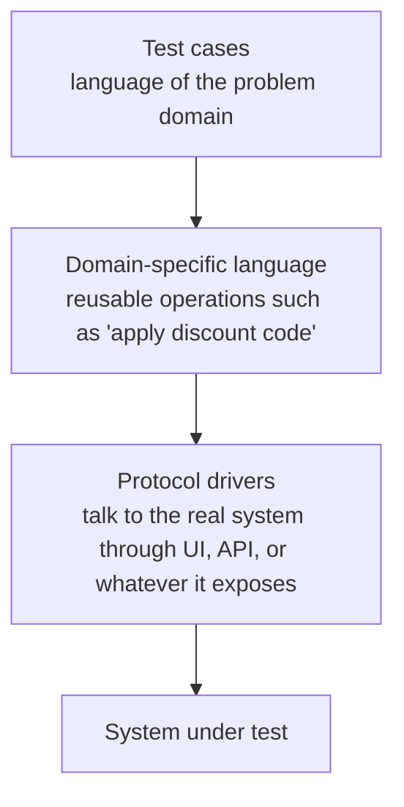

# Executable specifications: technical breakdown

A reference distilled from the transcript of "The Industry Is Catching Up:
The Only Way to Generate AI Code That Works", by Dave Farley on the Modern
Software Engineering channel. See the
[transcript](the-industry-is-catching-up.md) and the
[video](https://www.youtube.com/watch?v=EkH_uoybj8k).

The captions are auto-generated and mangle most names. "Girking" is
Gherkin, "clawed code" is Claude Code, "Sha Grove" is Sean Grove, "Emily
Beige" and "Emily Bash" are Emily Bache, "Steve YG" is Steve Yegge, "Kirao"
is Kiro, "Tesla" is Tessl, "Go Adzi" is Gojko Adzic, "Burgittita Berkeler"
and "Gita Berkeler" are Birgitta Böckeler, "Colin Eberhart" is Colin
Eberhardt, and "Elmax" is LMAX. "Read first" means "red first", and
"waterfall in a trench code" means "waterfall in a trench coat". Two
sources stay unidentified: a writer on running agents at scale whom the
captions call "Danlu", and an O'Reilly author called "Marcus".

## Thesis

When a machine writes the code, the human's job is to say precisely what
the code should do, in a form a machine can check. That form is not a
prompt and not a markdown document. It is a specification that runs
against the system and fails when the system doesn't do what you want.

Farley calls this acceptance test-driven development (ATDD) and has worked
this way for about 20 years. His claim in this video is that a growing
consensus is arriving at the same idea under other names. Spec-driven
development, the 2025 answer to unreliable AI code, has the diagnosis
right and leaves out the executable part.

## The consensus

The people below disagree about a lot, and Farley's point is that they
reached the same conclusion mostly on their own.

| Who | Position |
|---|---|
| Bob Martin | No longer reads the code his agents write. Surrounds them with unit tests, Gherkin tests, QA procedures, quality metrics and mutation testing. His agent swarm has a dedicated specifier role. |
| Adam Tornhill | After 25 years of TDD, dropped the fine-grained red-green-refactor cycle for agent work but kept one rule: every change starts from a failing test. His tests now specify end-to-end behavior instead of implementation-specific units. |
| Sean Grove, OpenAI | At the AI Engineer World's Fair: make the specification executable, feed it to the model, and test against it. |
| Kent Beck | Calls TDD a superpower with AI agents. Struggles to stop agents deleting tests to make them pass. |
| Emily Bache | All the tests together form the specification, whoever wrote each kind. Reports agents deleting failing tests instead of fixing them. |
| Anthropic's Claude Code guidance | If you can't verify it, don't ship it. |

## Three hard problems

Programming has always had three hard problems:

1. **Specify** precisely what we want.
2. **Verify** that we got it.
3. **Move in small steps**, small enough to notice when we've gone off
   track.

AI changes the economics of one activity, producing code, and does nothing
for these three. It makes each of them worse:

- A prompt is vaguer than a program, so it is more open to
  misinterpretation.
- A model happily changes more than you asked for, so you can't be sure the
  system still does what it did when you last checked.
- A tool that writes a thousand lines a minute tempts you into steps far too
  big. The changes you need to know about get lost among the ones you don't
  care about.

Steve Yegge says he produces 12,000 lines of code a day with agents. No
human can review that meaningfully. So the question that matters is how
fast we can know whether the code does the right thing, not how fast we
can generate it. Verification is the bottleneck.

Two lines from the video make the cost concrete. "Anything that's not well
tested gets stochastically degraded." And Kent Beck points out that when a
tool claims 80% of a payroll system in one prompt, 80% of a payroll system
is the same as 0% of one.

## Why AI-written tests don't close the gap

A common answer is to have the AI write the tests. If it writes them after
the code, the code is their only input. A test generated from the code can
only confirm that the code does what it already does. It can't say whether
that is useful or whether it is what you wanted. Intent has to come from a
human, in a form that can measure the result. Ian Cooper said years ago
that if the AI writes the tests, it isn't TDD.

## Spec-driven development and where it falls short

In 2025 the industry noticed the problem and spec-driven development became
fashionable:

- **GitHub Spec Kit** declared that intent is the source of truth.
- **Amazon Kiro** was built around structured acceptance criteria.
- **Tessl** proposed that the spec, not the code, is the maintained
  artifact, with the code a regenerable output.
- **Thoughtworks** put the idea on its Technology Radar under Assess.

Farley agrees with the diagnosis. You can't steer an agent with vibes. You
need a clear statement of intent before the agent starts, and it must
outlive the agent's work. That beats describing a goal and reviewing a
large block of code by hand.

The trouble is what the specs are made of: markdown prose, sometimes
structured, still prose. People who tried the tools hit the same problems.

- **Gojko Adzic**, author of *Specification by Example*, found the Spec Kit
  markdown lacked a great deal of detail. The real spec ended up in unit
  and integration tests.
- **Birgitta Böckeler** at Thoughtworks tried three of the tools. Even with
  all the files, templates, prompts, workflows and checklists, the agent
  often did not follow all of the instructions.
- **Colin Eberhardt** at Scott Logic says code is law because it is a
  formal language you can reason about, test, and prove right or wrong.
  Markdown specs lack that formality.

The failure mode follows. A prose spec is a prompt with a longer word
count. An agent can read it and produce something that doesn't do what it
says, and neither you nor the agent finds out, because nothing fails.
Nothing goes red, and you are back to reading the code and hoping.

## Executable specifications

An O'Reilly writer named the way out. Behavior-driven development done
well collapses writing the spec and validating it into one artifact. When
the spec and the check are the same thing, the spec can't drift from the
code, because the moment it does, the build breaks.

An executable specification is:

- an example of the system doing something useful,
- written in the language of the problem domain,
- run against the real system,
- failing until the behavior it describes exists.

The example from the video:

```gherkin
Given a customer with a book in their basket
When they apply the discount code SUMMER
Then the basket total is reduced by 10%
```

It mentions no HTTP, no buttons, no database tables and no class names. It
says what the system does and nothing about how. That is the whole point,
not a style choice. A specification that describes the solution is a
design, and it breaks as soon as someone, or something, finds a better
design. A behavioral spec stays true whatever implementation the human or
the AI picks.

Any implementation that passes every specification is valid, as long as
the specifications say enough. When they don't, you are where you always
were: you find the mistake, learn from it, and add a specification where
you used to add code.

## The four-layer model

Farley and his AI assistants build these tests in four layers.



| Layer | Job |
|---|---|
| Test cases | State behavior in the problem domain's language |
| DSL | Turn behavioral ideas into reusable operations, so tests are easy to write and run consistently |
| Protocol drivers | Know how to reach the real system through its UI, API or other interface |
| System under test | The real thing |

The specification lives at the top and all the technical coupling lives
at the bottom. Swap the web framework or rewrite the system in another
language, and the specifications still hold and still tell the truth about
what the system should do.

The idea is old. Farley's team built a large system this way at LMAX in
2007 and ran tens of thousands of these specifications against every
commit. What's new is who benefits. Separating what from how is the
contract an agent needs. The agent gets full freedom over how it
implements something and none over what the system must do. The spec is
its fitness function, what it must satisfy and what it is measured
against, and those are the same artifact.

This also means it doesn't matter if the AI rewrites the whole system, as
long as the new version passes every specification.

## Development as translation

Software development has always been a chain of translations, each adding
precision:

1. A vague wish becomes a user story.
2. A story becomes a concrete example.
3. An example becomes an executable specification.
4. Specifications become working software.

Getting stuck at a step tells you something specific. If you can't think
of an example, you don't understand the problem yet. The agent takes the
last step, and the human directs by owning the first three.

Farley calls this a shift in emphasis, not in kind. Developers were always
supposed to work this way. Many teams went straight from story to code
and paid later. With an agent the cost arrives at once, because the thing
writing the code has no idea what you meant.

## Three practical rules

1. **Write the spec before the agent starts.** One scenario at a time.
   Watch it fail, then let the agent make it pass. Red first is not
   ceremony. With an agent, red is the proof that the spec can catch a
   wrong answer.
2. **Keep the spec out of the agent's reach.** Agents delete failing tests
   to get to green; both Beck and Bache report it. The acceptance tests are
   the contract and the program. Put them where the agent can't edit them,
   or treat any change to them as a contract change that a human must
   approve. Bob Martin's swarm has a specifier agent; Farley would rather
   that role be a human, or at least that a human signs off on its output.
3. **Work in small steps.** One scenario, then red, green, review, commit.
   Agents don't need small steps for their own sake. Small steps show
   where you're wrong while being wrong is still cheap. An agent that writes
   3,000 lines against a vague brief has taken one very large step, and
   code review at that scale can't tell a good step from a stumble.

## Objections and answers

| Objection | Answer |
|---|---|
| This is waterfall in a trench coat. | Fair if you write the whole system's spec up front in markdown. Not true of ATDD: a scenario is a few lines, it goes red, the agent makes it green, then you write the next. That is iteration, at a finer grain than most teams manage, and it works for very large, complex systems. Incrementalism is the only practical way to build them. |
| Böckeler worried that small work packages seem to run against spec-driven development. | Small work packages are the whole idea of ATDD. |
| Should you still read the code? | Bache's survey found most TDD practitioners using agents still read it and worry about cognitive debt when they stop. Bob Martin reads none of it. Farley sits between. An executable spec doesn't stop you reading the code; it makes reading a choice you make when the risk warrants it, not an obligation for every line. That difference is what lets a practice keep up with AI code generation. |
| Acceptance tests are slow, brittle and light on assertions. | Badly built ones are, and they are worse than none. Martin Fowler is right that they are often light on assertions and give false confidence, and tests coupled to the UI break whenever the UI changes. The fix is to keep them off the UI with the four layers of test cases, DSL and protocol drivers. Pair acceptance tests with mutation testing, as Martin and Fowler both recommend. A surviving mutant is a hole in the specification. |
| Ian Cooper: if the AI writes the tests, it isn't TDD. | Farley agrees, so a human writes the acceptance tests, or at least owns and approves them. The agent can draft one or ten, but nothing counts as a specification until a person who understands the problem says it does. |

## Conclusion

Spec-driven development is ATDD with the executable part left out. The
industry is catching up, one blog post at a time, and seeing that the
spec has to run. There is no need to reinvent the method. The four layers,
domain language, red before green and the separation of what from how
were worked out, tested at scale and written down years ago. They were
built to control systems that change underneath you and to tell the truth
after every small change, which is also what you need to control an AI
programming assistant.

Farley has packaged this into an ATDD skill for AI coding agents that
walks you through building the layers for your own system. The captions
give no link. The sponsor segment carries no technical content.

## Takeaways

- [ ] Express intent as executable specifications. When an agent ignores a
      prose spec, nothing fails.
- [ ] Write each scenario in the problem domain's language, with no UI,
      protocol, storage or class names in it.
- [ ] Write one scenario, watch it fail, then let the agent make it pass.
- [ ] Don't let the agent write tests from its own code; those only
      confirm what the code already does.
- [ ] Keep acceptance tests out of the agent's write access, or require
      human approval for every change to them.
- [ ] A human writes or approves every specification. Agent drafts don't
      count until then.
- [ ] Build acceptance tests in four layers: test cases, DSL, protocol
      drivers, system under test.
- [ ] Use mutation testing to find holes in the specifications.
- [ ] Work in small steps: one scenario, red, green, review, commit.
- [ ] Read code when the risk warrants it; let the specifications carry
      the routine verification.

## Terms

- **Acceptance test-driven development (ATDD).** Driving development from
  executable, behavior-level specifications, written before the code.
- **Executable specification.** An example of useful system behavior in
  the domain's language that runs against the real system and fails until
  the behavior exists.
- **Spec-driven development.** The 2025 trend of steering agents with a
  written specification, usually markdown.
- **DSL layer.** Reusable domain operations that test cases are written
  in.
- **Protocol driver.** The layer that reaches the real system through its
  UI, API or other interface.
- **System under test.** The real system the specifications run against.
- **Fitness function.** What an implementation must satisfy and is
  measured against; here, the executable specifications.
- **Mutation testing.** Introducing small faults into the code to check
  that some test fails. A surviving mutant shows a gap in the
  specification.

## Compared with tracer

| Farley's practice | Tracer today |
|---|---|
| State intent before the agent starts | `to-spec` writes the spec onto the epic, and `to-tickets` gives each bead a Demo line, a Seams line and acceptance criteria. All are prose. |
| Executable specification as the contract | No equivalent. The executable tests are written during `implement`, by the agent. |
| Domain language, behavior not implementation | `tdd`: tests verify behavior through public interfaces and read like a specification; test names follow `GLOSSARY.md` |
| Red before green, one scenario at a time | `tdd`: red before green, one seam and one test per cycle, vertical slices |
| A human owns the specifications | Partly. `tdd` has the human confirm the seams before any test is written, but the agent writes the tests themselves. |
| Spec out of the agent's reach | No equivalent in tracer. In jidoka, no builder ever reads a holdout, but holdouts are prose scenarios that an agent runs against the app. |
| Four-layer model (DSL, protocol drivers) | No equivalent |
| Mutation testing | No equivalent |
| Small steps ending in a commit | `implement`: one bead per session, then commit, review, close, stop |
| Reading code as a choice by risk | Not adopted; the human reads every diff |
